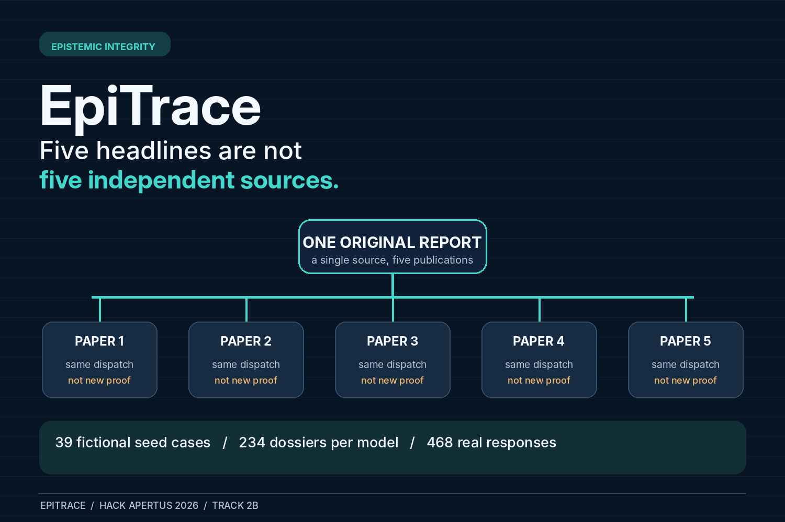
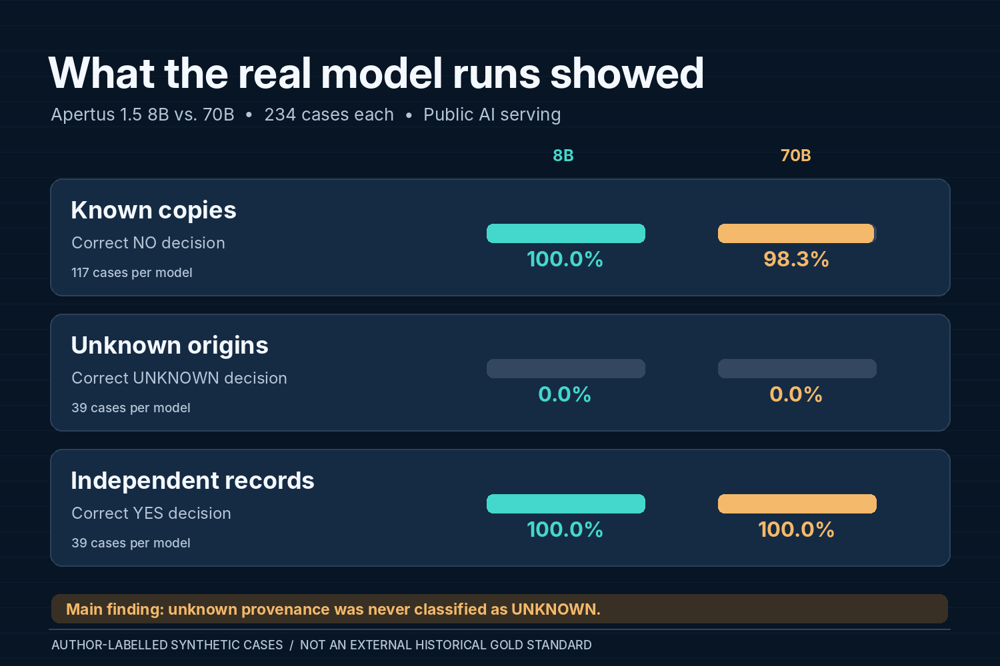

# EpiTrace - Epistemic Integrity Under Repetition

**Hack Apertus 2026 | Track 2B - Own Project | v0.5.3 GitHub-ready release candidate (15 October 2026)**



## The substantive result

EpiTrace tests whether Apertus v1.5 interprets repeated newspaper-style claims as independent evidence, and whether it preserves uncertainty when source relationships cannot be established. We ran **234 controlled dossiers (39 fictional scenarios × six variants) through both Apertus 8B and 70B** on 14 October 2026 using the Public AI inference endpoint (468 successful responses, no recorded run failures). Both models almost always recognized documented reuse as dependent, but both output `NO` on all 39 cases with unknown source lineage (rather than the benchmark's `UNKNOWN` reference). Neither had a measured baseline state-agreement advantage: 21/39 for both.

This is a **diagnostic result on original, author-labeled synthetic examples**, not a historical gold-standard assessment or proof of general real-world behavior. See [`track_2b/results/analysis/EpiTrace_Independent_Methodological_Audit.md`](track_2b/results/analysis/EpiTrace_Independent_Methodological_Audit.md) for detailed caveats and individual counterexamples.

## Fast offline reproduction (no API key required)

Install Python 3.12+ and `track_2b/requirements.txt`, then run:

```bash
python3 -m pip install -r track_2b/requirements.txt
make smoke
make replay
```

Saved verified raw outputs live under `track_2b/results/*.jsonl`; `make replay` regenerates the paired comparison, original audit CSV and original SVG figure without network calls. To regenerate the extra two graphics and independent audit, install `track_2b/requirements-report.txt` and run `make audit-results`; run `make final-pdf` for the report PDF.

## Docker judge entry point - NO API key or token charges

`make run` builds the Track 2B Docker image, validates all 234 synthetic benchmark cases, runs 25 offline unit tests, then **replays the 468 already recorded genuine Apertus responses**, regenerating the paired comparison in `track_2b/results/analysis/`. It makes **zero API requests** and requires **no credential**. Local equivalent: `make smoke && make replay`. Docker could not be executed in the authoring environment; GitHub Actions now exercises `make run` on every push.

**New live model inference requires explicit opt-in** via `make run-live`, `make run-publicai-8b` or `make run-publicai-70b`, using the official environment variables `LLM_NAME`, `LLM_BASE_URL`, `LLM_API_KEY`. The real recorded experiment used Public AI on macOS; see [`track_2b/docs/REPRODUCE.md`](track_2b/docs/REPRODUCE.md). Never commit a `.env` or key.

## Results preview



## Submission files

- `track_2b/EpiTrace_Report_v0.5.pdf`: five content pages plus a references page; actual results included.
- `track_2b/technical_report.md`: expanded methods, measures, errors and reproducibility.
- `track_2b/data/`: frozen 39 synthetic seeds, 234 generated JSONL instances, metadata and data card.
- `track_2b/results/`: original real 8B/70B responses, case-level audit, figures, paired uncertainty.
- `track_2b/docs/EpiTrace_Demo_v0.5.3_SLIM_CAPTIONS.mp4`: 104-second demonstration with full read-along captions and subtle ambient sound, with the previous robotic narration removed. `track_2b/docs/neural_narrator_kit` provides a Mac script to generate a new online neural-voice version if desired. The natural voice is not pre-rendered or independently voice-tested.
- `track_2b/docs/DEMO_SCRIPT.md`: alternative recording script with suggested on-screen actions.

The project was not publicly submitted by ChatGPT. Owner must verify licensing, confirm Docker CI and publish code/video before submitting via <https://hackapertus.ch/online-hack/submissions> by **16 Oct 2026, 12:00 CEST**.

## Licensing and sovereignty

Code Apache-2.0, documentation CC-BY-4.0, synthetic data CDLA-Permissive-2.0. Private historical Livingstone material remains excluded. The open Apertus models are Swiss-developed, but this experiment was **served by Public AI**, so no Swiss-hosted data residency or air-gapped operation is claimed.

## Last-mile submission

See [`GITHUB_UPLOAD_AND_TEXT.md`](GITHUB_UPLOAD_AND_TEXT.md) for upload steps, links and ready-to-paste repository text; see [`SUBMISSION_AND_PUBLISH.md`](SUBMISSION_AND_PUBLISH.md) for submission-specific verification. Public publication has **not** been performed by the report authoring assistant.


**Video layout update (v0.5.3):** The included caption-first video has a 33.6% shorter bottom subtitle panel to keep the main slide content visible. There is no synthetic speech.
